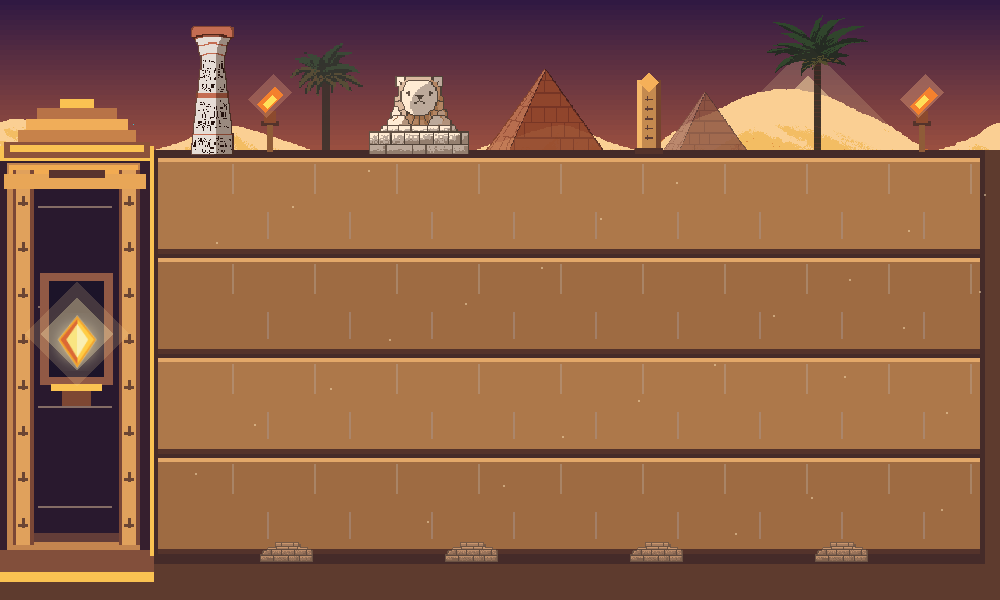

# Guardians of the Sun Temple

Modules 1 and 2 provide the C++20/OpenGL 3.3 engine and a themed four-lane battlefield. Guardian, enemy, economy, wave, and menu systems are planned for later modules. The assignment requirements and theme mapping are in [PROJECT_REFERENCE.md](PROJECT_REFERENCE.md).

## Build and run

Open this directory in CLion using the existing CMake profile, vcpkg toolchain, and `x64-mingw-dynamic` triplet. Build and run `Guardians_of_the_Sun_Temple`. The vcpkg manifest installs GLFW, GLAD, GLM, and stb.

On Windows, the build copies GLFW and the MinGW runtime DLLs beside the executable, so the built game can also launch directly from `cmake-build-debug/`.

The window begins at 1000 x 600 and can be resized. The scene keeps a 1000 x 600 logical world with letterboxing. Mouse input is converted through the active viewport, so lane selection continues to align after resizing and on high-DPI displays.

## Current controls

- Move the mouse over a path to highlight its full playable area.
- Left click a path to select or deselect it. Several paths can stay selected.
- Escape pauses or resumes environment animation and lane selection.

W, S, Up, and Down are already tracked by `InputManager`. They will control guardians in the guardian module.

## World coordinates

World coordinates start at the upper-left corner. X increases to the right and Y increases downward. `Battlefield` owns four fixed lanes, each 100 logical units high. Its API supplies lane bounds, guardian and enemy entry points, a stationary defender anchor, high/middle/low projectile positions, collectible positions, hover state, and selected lane IDs. `HomeBase::reachedBy` checks the loss boundary at X = 154.

## Scene and assets

`TempleEnvironment` renders layered sky, dunes, pyramids, lanes, sandstone details, moving sand, torch flames, obelisks, pillars, a sphinx, and palms. `HomeBase` renders the Sun Crystal shrine with a pulsing glow. The props from the free Egypt pack are credited in [ASSET_CREDITS.md](ASSET_CREDITS.md). The original ZIP remains untouched; only the files used by the scene were copied into `assets/environment/kimssuki/`.

## Tests

Build `world_geometry_tests` or run `ctest --test-dir cmake-build-debug --output-on-failure`. This checks lane hit testing, multiple selection, spawn and projectile coordinates, the home boundary, and mouse mapping through a resized high-DPI letterboxed viewport.

For a one-frame OpenGL capture, set `GOST_CAPTURE_PATH` to a PNG path before running the game. The application renders one frame, saves it, then exits.

## Source layout

- `src/core/`: GLFW/GLAD lifecycle, delta-time loop, and input state.
- `src/rendering/`: shader and texture ownership, indexed quad renderer, sprites, and orthographic camera.
- `src/world/`: lane geometry and selection, shrine boundary, and temple environment.
