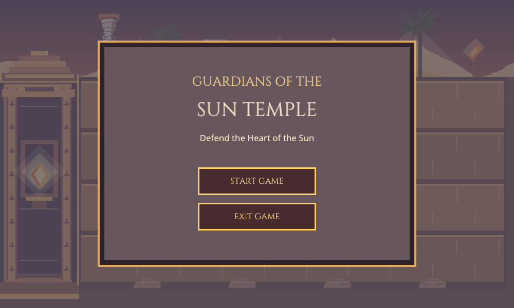
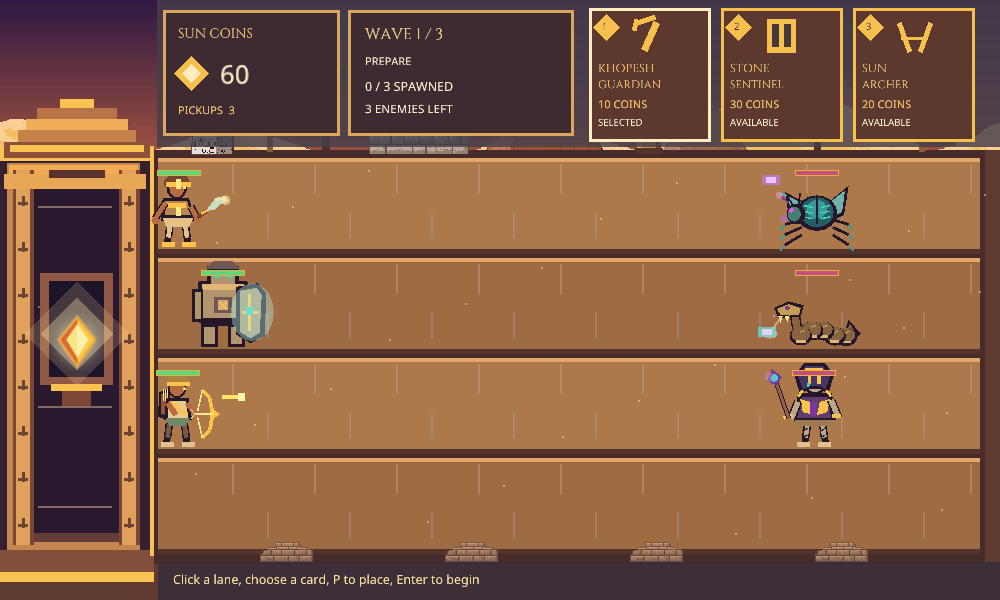
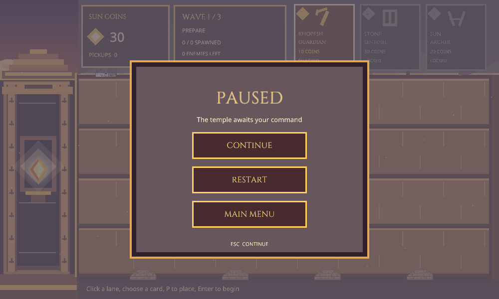

# Guardians of the Sun Temple

Modules 1-8 provide the C++20/OpenGL 3.3 engine, four-lane battlefield, six animated character models, three guardian types, three enemy waves, unified combat, Sun Coin economy, gameplay HUD, and menus. The assignment requirements and theme mapping are in [PROJECT_REFERENCE.md](PROJECT_REFERENCE.md).

## Build and run

Open this directory in CLion using the existing CMake profile, vcpkg toolchain, and `x64-mingw-dynamic` triplet. Build and run `Guardians_of_the_Sun_Temple`. The vcpkg manifest installs GLFW, GLAD, GLM, and stb.

On Windows, the build copies GLFW and the MinGW runtime DLLs beside the executable, so the built game can also launch directly from `cmake-build-debug/`. The game opens at the Main Menu.

The window begins at 1000 x 600 and can be resized. The scene keeps a 1000 x 600 logical world with letterboxing. Mouse input is converted through the active viewport, so lane selection continues to align after resizing and on high-DPI displays.

## Play the game

- Click **Start Game** on the Main Menu. The preparation screen starts with 30 Sun Coins. Khopesh is available; the other two cards are gray and locked.
- Click a path to select or deselect it. Several paths can stay selected. Hover the intended selected path if several are selected.
- Click an available guardian card or press 1/2/3, then press P to purchase it in the selected path. The HUD updates the balance immediately. A failed purchase does not charge coins.
- Press Enter to begin Wave 1. W/Up jumps and S/Down ducks guardians in selected paths. Guardian and enemy health bars stay above their models.
- A defeated enemy drops a coin; a guardian must touch it to collect 10 Sun Coins. Archer becomes eligible after two pickups and Sentinel after three. Cards also require enough current coins, so they can gray out again after spending.
- Press Escape to pause. Click Continue, Restart, or Main Menu. Victory and defeat each offer Restart and Main Menu. The Main Menu has Exit Game.
- The wave, spawned count, remaining enemies, balance, pickups, card names, costs, and availability appear on screen.

The assignment's opening cutscene is outside Module 8. Start Game currently enters the playable preparation state directly.

## Development inspection modes

- During gameplay, F4 opens or closes Guardian Practice. F5 switches back to the wave view or toggles it with the character showcase. These shortcuts enable the earlier practice controls.
- In the showcase, F3 shows or hides the six-character lineup. Keys 1-7 select Idle, Moving, Attacking, Jumping, Ducking, TakingDamage, or Dying. Press 0 to resume automatic cycling, H to step through health tint, and R to restore full health.

## Test the guardians (F4)

- Press F4 to open or close Guardian Practice mode.
- Click a lane to select it. Several lanes can stay selected; hover the intended lane before placing if several are selected.
- Press 1 for Khopesh (10 coins), 2 for Stone Sentinel (30), or 3 for Sun Archer (20). Press P to place one guardian in the chosen lane. The temporary wallet starts with 30 coins; its balance and action messages appear in the window title.
- Press T to add a stationary training target in the chosen lane. Khopesh should stop at it, strike it, and continue after it falls. Archer should fire Sun Arrows that hit it without hurting friendly guardians. Press K to remove the target.
- Press W or Up to make all movable guardians in selected lanes jump; hold S or Down to duck. The Sentinel stays still and never jumps or ducks.
- Press H to damage all guardians in the chosen lane by 1 point; their gold-bordered health bars shrink and models redden. Press R to reset guardians, targets, and wallet so each type can be tried from the initial balance.

This is an isolated test mode with its own wallet. F4 uses the same combat collision and damage rules as the playable wave session.

## Test the enemy waves (F5)

- Start the normal game from the Main Menu. For the earlier debug controls, press F5 twice to leave and return to the wave view. It starts with 30 Sun Coins. Only Khopesh is initially active; the gray Archer and Sentinel cards cannot be selected yet.
- Click a lane, then press 1/2/3 or click an active top card to choose Khopesh/Sentinel/Archer, and press P to purchase one. Unavailable cards ignore mouse selection. You can continue buying during a wave when the card is active and funds are sufficient.
- Press Enter to start Wave 1. The window title shows the wave number, whether it is spawning or clearing, spawned/total count, and living enemy count. Wave 1 has 3 Scarabs; Wave 2 has 3 Scarabs and 2 Serpents; Wave 3 has 4 Scarabs, 3 Serpents, and 3 Pharaohs.
- Use W/Up to jump over low Serpent attacks and hold S/Down to duck under high Scarab attacks. Pharaohs strike at close range for 2 damage. Enemy and guardian health bars show their remaining HP.
- Each defeated enemy drops a gold Sun Coin. A guardian must touch it to collect it; every pickup adds 10 to the balance. After two pickups, Archer is eligible; after three, Sentinel is eligible. A card still needs the current balance to cover its 10/20/30 cost, so spending can gray it out again. The top-left panel shows spendable coins and the window title shows pickups.
- In debug mode, press K to defeat current enemies and inspect transitions. Kills alone do not pay; a guardian must still collect the coin. The next wave begins only after its last spawn and all its enemies are defeated. Press R to reset the mode and wallet. In normal play, use Restart in the Pause Menu.
- If any enemy reaches the shrine, the Defeat Menu appears. Clearing all three waves shows the Victory Menu.

## Test combat and Sentinel protection (F5)

- For a repeatable shield test, enter the F5 debug mode described above, press **R**, then **T**. This creates a stationary Khopesh Guardian behind a Stone Sentinel and a nearby Scarab in lane 1. The first high cursed shots should reduce the Sentinel's health while the Khopesh remains at 5 HP.
- Press **Y** to move the Khopesh ahead of the Sentinel. Later shots should damage the Khopesh directly. Press Y again to return it behind the shield.
- Press **H** to destroy the Sentinel. Subsequent shots can now hit the guardian behind it. Press **R** to clear this test before starting the normal waves.
- The T/Y/H shield scenario creates its characters as a test fixture without spending Sun Coins. Press R to return to the normal 30-coin start before testing purchases and waves.

## World coordinates

World coordinates start at the upper-left corner. X increases to the right and Y increases downward. `Battlefield` owns four fixed lanes, each 100 logical units high. Its API supplies lane bounds, guardian and enemy entry points, a stationary defender anchor, high/middle/low projectile positions, collectible positions, hover state, and selected lane IDs. `HomeBase::reachedBy` checks the loss boundary at X = 154.

## Scene and assets

`TempleEnvironment` renders layered sky, dunes, pyramids, lanes, sandstone details, moving sand, torch flames, obelisks, pillars, a sphinx, and palms. `HomeBase` renders the Sun Crystal shrine with a pulsing glow. The props from the free Egypt pack are credited in [ASSET_CREDITS.md](ASSET_CREDITS.md). The original ZIP remains untouched; only the files used by the scene were copied into `assets/environment/kimssuki/`.

The six characters are built from code-drawn shapes and articulated parts, so no new character image assets are required. `CharacterRenderer::draw` accepts a character type, animator, feet position, facing, scale, and normalized health from the guardian and enemy systems. The Stone Sentinel's Attacking pose is its shield activation, not a damage-dealing attack.

## Tests

Run `ctest --test-dir cmake-build-debug --output-on-failure`. The seven suites cover lane geometry, animation, guardian movement, exact wave composition, combat rules, economy transactions, and menu transitions/hit testing.

For a one-frame OpenGL capture, set `GOST_CAPTURE_PATH` to a PNG path before running the game. The application renders one frame, saves it, then exits.

For repeatable showcase captures, set `GOST_PREVIEW_STATE` to 0-6, optionally `GOST_PREVIEW_TIME` to seconds into that clip and `GOST_PREVIEW_DAMAGE` to 0-3, along with `GOST_CAPTURE_PATH`.

Set `GOST_PRACTICE_PREVIEW=1` with `GOST_CAPTURE_PATH` to capture a sample F4 guardian scene.

Set `GOST_WAVE_PREVIEW=1` with `GOST_CAPTURE_PATH` to capture a sample F5 enemy scene.

Set `GOST_ECONOMY_PREVIEW=1` with `GOST_CAPTURE_PATH` to capture the initial 30-coin card state.

Set `GOST_UI_PREVIEW` to `play`, `pause`, `win`, or `lose` with `GOST_CAPTURE_PATH` to capture a UI screen. With only `GOST_CAPTURE_PATH`, the Main Menu is captured.

## Source layout

- `src/core/`: GLFW/GLAD lifecycle, delta-time loop, and input state.
- `src/rendering/`: shader and texture ownership, indexed quads and polygon renderer, sprites, orthographic camera, character models, and animator.
- `src/world/`: lane geometry and selection, shrine boundary, and temple environment.
- `src/entities/` and `src/systems/`: guardian/enemy state, placement, random spawning, and wave phases.
- `src/combat/`: central contact, attack, projectile, damage, protection, and coin pickup rules.
- `src/economy/`: spendable currency, pickup credit, card availability, purchasing, and gameplay HUD.
- `src/ui/`: OpenGL font atlases, menu state and button hit testing, themed menu rendering.
- `src/demo/`: playable wave session plus character and guardian inspection modes.

Cinzel and Noto Sans are bundled in `assets/fonts/` under their included Open Font License files. The source fonts are from the Google Fonts repository.
