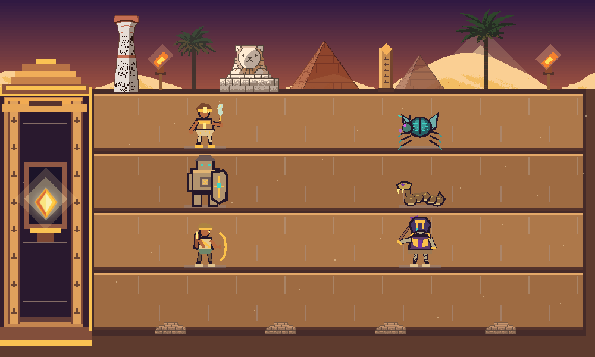
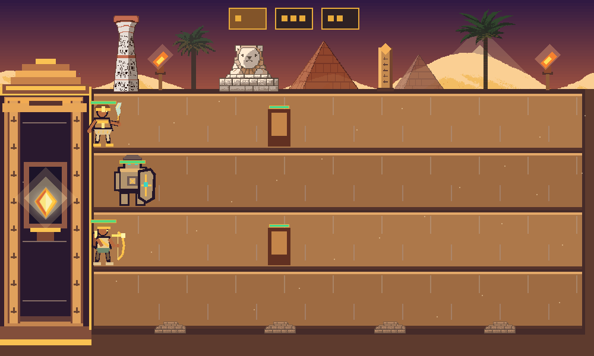

# Guardians of the Sun Temple

Modules 1-4 provide the C++20/OpenGL 3.3 engine, four-lane battlefield, six animated character models, and three playable guardian types. The final enemy, economy UI, wave, and menu systems remain for later modules. The assignment requirements and theme mapping are in [PROJECT_REFERENCE.md](PROJECT_REFERENCE.md).

## Build and run

Open this directory in CLion using the existing CMake profile, vcpkg toolchain, and `x64-mingw-dynamic` triplet. Build and run `Guardians_of_the_Sun_Temple`. The vcpkg manifest installs GLFW, GLAD, GLM, and stb.

On Windows, the build copies GLFW and the MinGW runtime DLLs beside the executable, so the built game can also launch directly from `cmake-build-debug/`.

The window begins at 1000 x 600 and can be resized. The scene keeps a 1000 x 600 logical world with letterboxing. Mouse input is converted through the active viewport, so lane selection continues to align after resizing and on high-DPI displays.

## Current controls

- Move the mouse over a path to highlight its full playable area.
- Left click a path to select or deselect it. Several paths can stay selected.
- Escape pauses or resumes environment animation and lane selection.
- F3 shows or hides the six-character animation showcase.
- In the showcase, 1-7 selects Idle, Moving, Attacking, Jumping, Ducking, TakingDamage, or Dying. Unsupported poses stay Idle.
- In the showcase, 0 resumes automatic pose cycling; H steps through visual health levels, and R restores full visual health.

## Test the guardians (F4)

- Press F4 to open or close Guardian Practice mode.
- Click a lane to select it. Several lanes can stay selected; hover the intended lane before placing if several are selected.
- Press 1 for Khopesh (10 coins), 2 for Stone Sentinel (30), or 3 for Sun Archer (20). Press P to place one guardian in the chosen lane. The temporary wallet starts with 30 coins; its balance and action messages appear in the window title.
- Press T to add a stationary training target in the chosen lane. Khopesh should stop at it, strike it, and continue after it falls. Archer should fire Sun Arrows that hit it without hurting friendly guardians. Press K to remove the target.
- Press W or Up to make all movable guardians in selected lanes jump; hold S or Down to duck. The Sentinel stays still and never jumps or ducks.
- Press H to damage all guardians in the chosen lane by 1 point; their gold-bordered health bars shrink and models redden. Press R to reset guardians, targets, and wallet so each type can be tried from the initial balance.

This is a temporary test mode. Training targets, wallet, and card markers will be replaced by later modules. The Sentinel's protection calculation is planned for the combat module.

## World coordinates

World coordinates start at the upper-left corner. X increases to the right and Y increases downward. `Battlefield` owns four fixed lanes, each 100 logical units high. Its API supplies lane bounds, guardian and enemy entry points, a stationary defender anchor, high/middle/low projectile positions, collectible positions, hover state, and selected lane IDs. `HomeBase::reachedBy` checks the loss boundary at X = 154.

## Scene and assets

`TempleEnvironment` renders layered sky, dunes, pyramids, lanes, sandstone details, moving sand, torch flames, obelisks, pillars, a sphinx, and palms. `HomeBase` renders the Sun Crystal shrine with a pulsing glow. The props from the free Egypt pack are credited in [ASSET_CREDITS.md](ASSET_CREDITS.md). The original ZIP remains untouched; only the files used by the scene were copied into `assets/environment/kimssuki/`.

The six characters are built from code-drawn shapes and articulated parts, so Module 3 needs no new image assets. `CharacterRenderer::draw` accepts a character type, animator, feet position, facing, scale, and normalized health. Future entity systems will supply those values. The Stone Sentinel's Attacking pose is its shield activation, not a damage-dealing attack.

## Tests

Run `ctest --test-dir cmake-build-debug --output-on-failure`. `world_geometry_tests` checks lane and coordinate rules, `animator_tests` checks animation timing, and `guardian_tests` checks placement, wallet safety, health, movement, control actions, melee contact, and Sun Arrows.

For a one-frame OpenGL capture, set `GOST_CAPTURE_PATH` to a PNG path before running the game. The application renders one frame, saves it, then exits.

For repeatable showcase captures, set `GOST_PREVIEW_STATE` to 0-6, optionally `GOST_PREVIEW_TIME` to seconds into that clip and `GOST_PREVIEW_DAMAGE` to 0-3, along with `GOST_CAPTURE_PATH`.

Set `GOST_PRACTICE_PREVIEW=1` with `GOST_CAPTURE_PATH` to capture a sample F4 guardian scene.

## Source layout

- `src/core/`: GLFW/GLAD lifecycle, delta-time loop, and input state.
- `src/rendering/`: shader and texture ownership, indexed quads and polygon renderer, sprites, orthographic camera, character models, and animator.
- `src/world/`: lane geometry and selection, shrine boundary, and temple environment.
- `src/entities/` and `src/systems/`: shared guardian state, placement, controls, attacks, and Sun Arrows.
- `src/demo/`: character showcase and temporary guardian practice mode.
